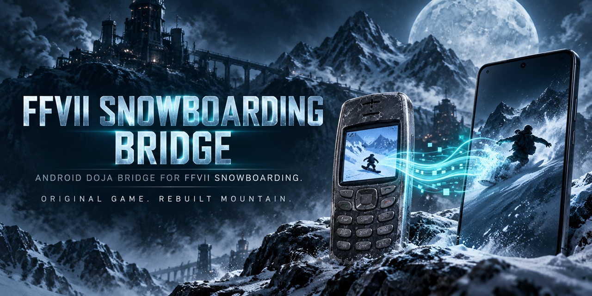

# FFVII Snowboarding Bridge



Play the preserved **Final Fantasy VII Snowboarding** mobile game on modern Android with 3D gameplay, music, and touchscreen controls.

## Play with Omni Player

For a streamlined way to play **Final Fantasy VII Snowboarding**, I recommend **Omni Player**.

Omni includes this game's compatibility bridge and can import the complete English offline game archive directly, without the standalone Windows Payload Builder. Keep the JAR, JAM descriptor, and scratchpad together as described in the guide below.

**[Download Omni Player](https://github.com/Wakkatobakka/Omni-Player/releases) · [Game files and setup guide](https://github.com/Wakkatobakka/Omni-Player/blob/main/GAME_GUIDE.md#final-fantasy-vii-snowboarding)**

Requires **Android 11+ / ARM64**. Original game files are not included.

To use the dedicated standalone Snowboarding Bridge app, follow the instructions below.

---

## Quick Start

1. Open the [v0.1.2 Release](https://github.com/Wakkatobakka/FFVII-Snowboarding-Bridge/releases/tag/v0.1.2).
2. Download and install `FFVII_Snowboarding_Bridge_v0.1.2.apk` on your Android device.
3. Download and extract `FFVII_Snowboarding_Payload_Builder_v0.1.0.zip` on Windows.
4. Run `RUN-PAYLOAD-BUILDER-WINDOWS.bat`.
5. Select your compatible Snowboarding JAR and SP files.
6. The builder creates `FFVII_Snowboarding_Data_for_Bridge_v0.1.2.zip`.
7. Transfer the generated ZIP to your Android device.
8. Open Snowboarding Bridge and tap **IMPORT GAME DATA**.
9. Select your ZIP. Once verified, tap **HIT THE SLOPES**.

**Note:** Original game data is not included. You'll need compatible Final Fantasy VII Snowboarding game files.

## Getting the Game Files

The original **Final Fantasy VII Snowboarding** mobile game can be found through Keitai World Archives:

[Download Keitai World Launcher](https://keitaiarchive.org/KeitaiWorldLauncher.zip)

[Keitai Archive Downloads](https://keitaiarchive.org/downloads.html)

Inside Keitai World Launcher, locate **Final Fantasy VII Snowboarding** and obtain the compatible game files.

### Required Files

The Payload Builder supports the following pair:

- `game-offline-english.jar`
- `game-offline-english.sp`

Both files are required. The Payload Builder will verify them and prepare the import ZIP automatically.

All preparation and importing happen locally.

## What Works

- Original 240×240 DoJa game presentation
- 3D Snowboarding gameplay
- Restored music and audio
- Original phone keypad
- Custom two-handed touchscreen controls
- Pause and resume
- Offline gameplay after importing
- In-app diagnostics and report export

## Controls

The original phone keypad is fully accessible.

A custom two-handed layout is also available for more comfortable gameplay.

```text
EDGE LEFT        KICK        EDGE RIGHT
TURN LEFT        JUMP        TURN RIGHT
                 BRAKE

Retry                              Menu
```

During menus, the controls switch to **Left / Up / OK / Down / Right** navigation.

## Compatibility

FFVII Snowboarding Bridge v0.1.2 has been tested on a **Samsung Galaxy S25 Ultra running Android 16**.

Compatibility with other Android devices and versions may vary.

## About This Project

FFVII Snowboarding Bridge is an independent compatibility project created to make the preserved mobile version of Final Fantasy VII Snowboarding playable on modern Android devices.

This project is not affiliated with or endorsed by Square Enix or NTT DOCOMO.

Original game content belongs to its respective rights holders.
